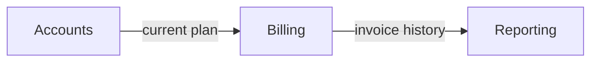
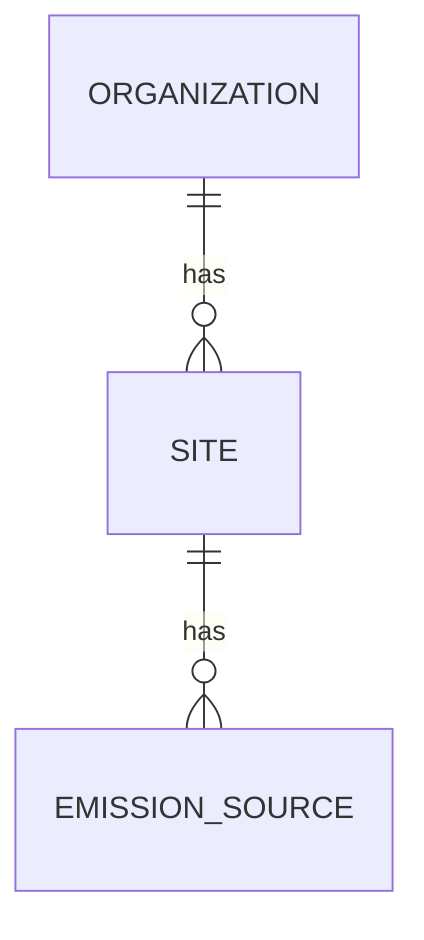

# Architecture (L1)

Status: {{draft — questions open / final}}

How the product is divided into modules and how they relate — as behaviour, not as technology.
A module is an area of behaviour a user or operator would name. After the phase-3 gate this map is
frozen: a module is added, split, merged, renamed or removed only through `/blueprint restructure`.

## Module map

| Module | Code | Responsibility | Main actors | Surfaces | Stage | Sources | Ref |
|--------|------|----------------|-------------|----------|-------|---------|-----|
| {{Accounts}} | {{ACC}} | {{one line: what it is accountable for}} | {{actors}} | {{web / mobile / both / web · mobile read-only}} | {{MVP / next / later / in scope / out of scope}} | {{S-03 §ACC}} | (D-nnn) |

## Relationships

What each module needs from others and gives to others, from the user's point of view.

| Module | Needs from | What | Provides to | What |
|--------|------------|------|-------------|------|
| {{Billing}} | {{Accounts}} | {{the current plan and seat count}} | {{Reporting}} | {{invoice history}} |

## Main flows

End-to-end journeys that cross module boundaries; 3–7 of them. Each step names the module and the
surface. A flow that changes surface says how the user continues.

### Flow 1 — {{name, e.g. "First report from an empty account"}}

1. {{Actor}} {{does X}} — *{{Module}}* · {{surface}}
2. {{System}} {{does Y}} — *{{Module}}*
3. {{Actor}} {{continues on another surface: how they get there}} — *{{Module}}* · {{surface}}
4. …

## Domain model

The things the product is about, across modules: the module that owns each, its states, what it
relates to, and whether it holds personal data. Concepts, not a database schema — no fields, no
types. Each module's file describes the entities it owns; a new entity is added here first. The
brief's privacy requirements apply to every entity with personal data, and the adequacy review
checks that each has capabilities for who sees it, how it is exported and how it is removed.

| Entity | Owned by | States | Relates to | Personal data | Ref |
|--------|----------|--------|------------|---------------|-----|
| {{Site}} | {{ORG}} | {{active → archived}} | {{belongs to an Organization; has Emission sources}} | {{none / contact details / location / financial / health…}} | (S-nn) |

## Roles and access

The roles of the brief against the modules — the coarse picture that each module's *Access* table
refines capability by capability. When a source has a permission matrix, this starts from it.

| Role | {{ACC}} | {{BIL}} | {{REP}} | Ref |
|------|---------|---------|---------|-----|
| {{Administrator}} | manage | manage | read | |
| {{Member}} | use | — | read | |

`manage` — configure and change everything in it · `use` — do the work it exists for · `read` —
see, not change · `—` — no access.

## Cross-cutting concerns

One sub-section each. State how the concern applies to every module, and where its own rules live.

### Access control
{{Who can see and do what, in general; where roles are managed}} (D-nnn)

### Audit and history
{{What is recorded about changes, for whom}}

### Notifications
{{Channels, who decides what is sent, user control}}

### Data import and export
{{Formats, scope, who may}}

### Localisation
{{Languages, units, regional formats}}

### Errors and recovery
{{How failures are shown; what can be undone}}

### Surface parity
{{Only when there are several surfaces. What a user sees when a capability exists on another
surface only — a message saying where to continue, a read-only view, nothing; how a flow that
changes surface hands over}} (D-nnn)

## Boundaries

- **Not part of the system:** {{things nearby that are explicitly outside}} (D-nnn)
- **Relies on:** {{external systems or services, described by what they provide}}
